# El Pistón · Gestión del taller

Aplicación móvil (Flutter, Android) para llevar el trabajo diario de un taller
mecánico de barrio con dos mecánicos y una recepcionista. Reemplaza la libreta
y las notas sueltas.

- **Funciona sin conexión**: todo se guarda en una base SQLite en el teléfono.
- **Conserva los datos** aunque la aplicación se cierre.
- Asignatura: Programación para Dispositivos Móviles · Actividad individual.

## Cómo ejecutarla

Requisitos: Flutter 3.24 o superior (Dart 3.5+), con el entorno de Android
configurado (`flutter doctor` sin errores).

```bash
flutter create . --platforms=android   # crea la carpeta android/ (solo la primera vez)
flutter pub get
dart run build_runner build --delete-conflicting-outputs   # genera los *.g.dart de Drift
dart run flutter_launcher_icons                            # genera el ícono de la app
flutter run
```

El nombre que aparece bajo el ícono se define en
`android/app/src/main/AndroidManifest.xml` (`android:label="El Pistón"`).

Para probar rápido: **Inicio → ⚙ Ajustes → Cargar datos de ejemplo** agrega
clientes, vehículos, repuestos y órdenes de muestra (solo con la base vacía).

Pruebas de las reglas de negocio (base en memoria):

```bash
flutter test
```

## Qué necesita saber el dueño y dónde lo ve

| Pregunta del enunciado | Dónde se responde |
|---|---|
| Qué órdenes están abiertas y en qué estado | **Inicio** (contador y chips por estado) y **Órdenes** (filtros por estado, búsqueda) |
| Cuánto trabajo tiene cada mecánico | **Inicio** (barras de carga) y **Mecánicos** (órdenes abiertas por estado) |
| Historial de un vehículo y de un cliente | **Clientes → cliente** y **Clientes → vehículo** |
| Cuánto debe cada cliente | **Reportes → Clientes con saldo pendiente** y saldo en la ficha del cliente |
| Qué repuestos están por agotarse | Tarjeta roja en **Inicio**, insignia en la pestaña **Inventario**, filtro "Por agotarse" y aviso al usar un repuesto |
| Cuánto se facturó en un período | **Reportes** (hoy, semana, mes o fechas a elegir) |

## Pantallas

1. **Inicio**: indicadores (abiertas, por cobrar, repuestos por agotarse), carga por mecánico, alertas y últimas órdenes.
2. **Órdenes**: lista con búsqueda y filtros; **Nueva orden**; **Detalle de la orden** (estado, trabajos, repuestos, cobro y pagos).
3. **Clientes**: lista con búsqueda por nombre, teléfono o matrícula; ficha del cliente; ficha del vehículo; formularios de alta y edición.
4. **Inventario**: repuestos con existencias, reposición, alta y edición.
5. **Reportes**: facturación por período y deudas.
6. **Mecánicos** y **Ajustes** (modo claro/oscuro, datos de ejemplo), accesibles desde Inicio.

## Decisiones de diseño

### Modelo de datos (Drift / SQLite)

```
Clientes 1──* Vehiculos 1──* OrdenesServicio *──1 Mecanicos
                                  │1
                 ┌────────────────┼────────────────┐
                 *                *                *
             Trabajos     RepuestosUsados *──1 Repuestos     Pagos
```

- **Un cliente, varios vehículos; un vehículo, muchas órdenes.** La matrícula es única e identifica al vehículo cuando vuelve.
- **Kilometraje en dos sitios**: el vehículo guarda el de *la última vez*; cada orden guarda el de *esa visita*. Al crear una orden se actualiza el del vehículo, y no se permite uno menor al ya registrado.
- **El total no se guarda, se calcula**: mano de obra (suma de trabajos) + repuestos (cantidad × precio) y lo pagado (suma de pagos) salen de una sola consulta con subconsultas. Así nunca queda un total desactualizado.
- **El precio del repuesto se copia a la orden** (`precioUnitario`): si el repuesto sube mañana, las órdenes anteriores no cambian.
- **Pagos como tabla aparte**: permite pagar en dos (o más) partes y saber cuánto se pagó y cuánto falta. Un pago no puede superar el saldo.
- **Estado como enum** guardado como entero (`intEnum`), con las transiciones del flujo en el propio enum.

### Reglas de negocio (todas en transacciones, en el DAO)

- Usar un repuesto en una orden **descuenta las existencias**; quitarlo las **devuelve**. Si no hay suficientes, se rechaza.
- Al **cancelar** una orden, los repuestos vuelven al inventario y la orden **no se factura**.
- Una orden **entregada o cancelada ya no se modifica** (ni trabajos, ni repuestos, ni estado). Al entregar con saldo pendiente se pide confirmación.
- No se puede quitar un trabajo o repuesto si el total quedaría por debajo de lo ya pagado.
- Si algo falla a mitad de una operación, **no queda nada a medias** (transacción).

### Decisiones donde el enunciado dejaba el punto abierto

- **"Pocas unidades"**: cada repuesto tiene su *stock mínimo* (por defecto 3). Se avisa cuando las existencias llegan a ese mínimo o menos.
- **"Facturado"**: total de las órdenes **recibidas en el período**, sin las canceladas. Se muestra aparte **lo cobrado** (pagos recibidos en el período), porque no son lo mismo.
- **Dos mecánicos**: se crean al instalar con nombres genéricos, que el dueño renombra. Se pueden agregar más y desactivar (un mecánico inactivo no recibe órdenes nuevas pero conserva su historial).
- **Reparto de trabajo**: al crear una orden se sugiere el mecánico con menos órdenes abiertas.

### Arquitectura (MVVM, según las conferencias)

```
lib/
├── data/        Drift: tablas, base de datos, DAOs, datos de ejemplo
├── models/      Clases de dominio (OrdenResumen, EstadoOrden…)
├── viewmodels/  ChangeNotifier por módulo (Órdenes, Clientes, Inventario…)
├── views/       Pantallas y widgets (solo dibujan y llaman al ViewModel)
├── router/      GoRouter
├── theme/       Material 3 claro y oscuro
└── core/        Formato, errores, dependencias
```

- **View**: widgets que solo muestran datos y delegan las acciones.
- **ViewModel**: `ChangeNotifier` que escucha los *Streams* de Drift; cuando cambia la base, la pantalla se redibuja sola (`ListenableBuilder`). No hay `setState` para datos de negocio.
- **Model/Data**: Drift con **DAOs** separados por responsabilidad, **JOINs** para unir órdenes, vehículos, clientes y mecánicos, y **migraciones** preparadas (`schemaVersion`).
- Los ViewModels compartidos se crean una vez (`AppDependencies`) y se pasan por constructor, sin variables globales. Los de detalle (una orden, un cliente) se crean y liberan con su pantalla.

### Navegación (GoRouter)

Barra inferior de 5 pestañas con `StatefulShellRoute`: cada pestaña **conserva su propia pila** (si estás en el detalle de una orden y cambias a Inventario, al volver sigues ahí). Los formularios se abren a pantalla completa por encima de la barra. Rutas con parámetros (`/ordenes/:id`, `/clientes/vehiculos/:vid`).

### Experiencia de usuario

- **Material 3** con color de marca (naranja óxido) definido una sola vez; **modo claro, oscuro o del sistema**, recordado entre sesiones.
- **Adaptable**: barra inferior en teléfonos y riel lateral en tablets o en horizontal; el contenido se centra con ancho máximo.
- **Formularios con validación** mensajes en español y teclado adecuado (numérico, teléfono).
- **Menos escritura**: se elige el vehículo de una lista con buscador, el kilometraje se precarga, el monto del pago se sugiere con el saldo completo.
- **Siempre se sabe qué pasa**: estados con color e icono, saldo pendiente en rojo, avisos al quedar poco stock, confirmaciones antes de acciones que no se pueden deshacer, mensajes claros cuando una regla impide la acción.
- **Estados vacíos y de carga** en todas las listas.
- **Un botón para avanzar** la orden al siguiente estado del flujo.

## Capturas

Capturas de la aplicación en uso, tomadas en un teléfono Android real. Están
todas en la carpeta [`capturas/`](capturas/).

| Inicio | Órdenes | Detalle de la orden |
|:---:|:---:|:---:|
| 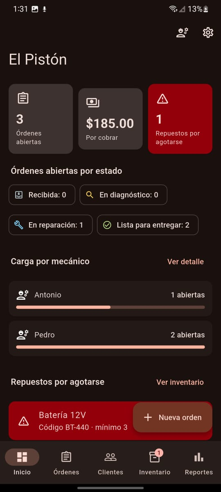 | 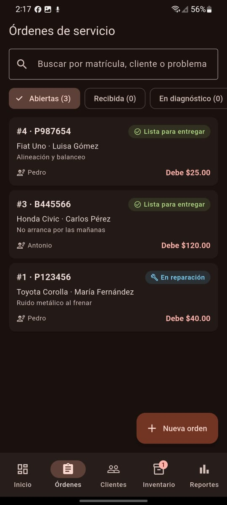 | 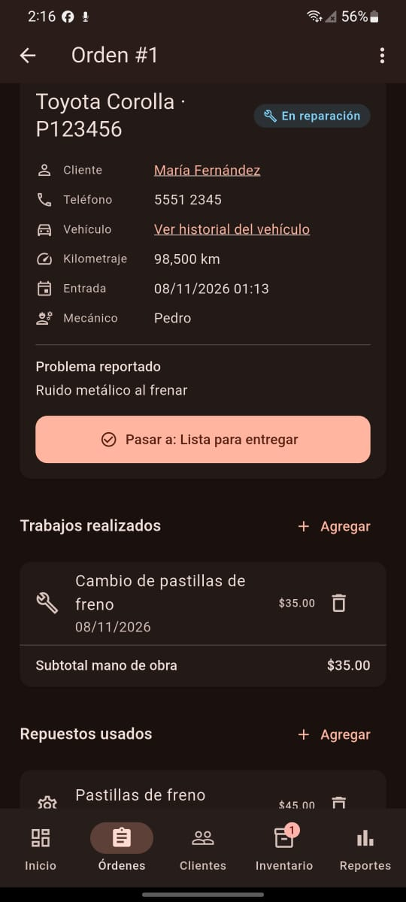 |
| Panel con indicadores, carga por mecánico y alerta de repuestos | Lista con búsqueda y filtros por estado | Trabajos y repuestos de una orden |

| Cobro y pagos | Registrar pago | Clientes |
|:---:|:---:|:---:|
| 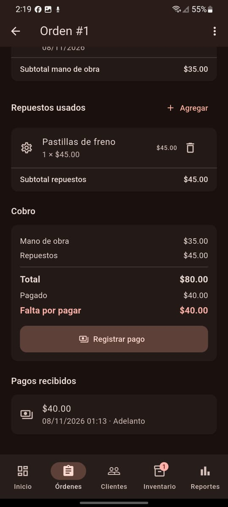 | 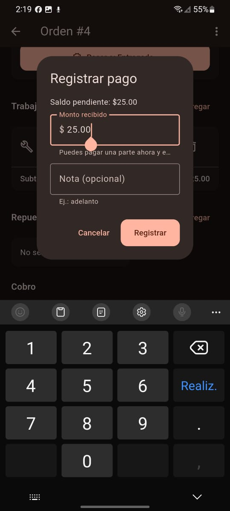 |  |
| Total, pagado y lo que falta | Pago parcial con el saldo sugerido | Búsqueda por nombre, teléfono o matrícula |

| Ficha del cliente | Historial del vehículo | Inventario |
|:---:|:---:|:---:|
| 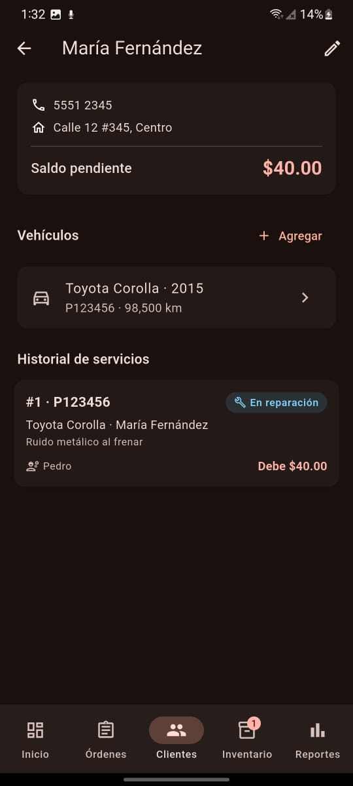 | 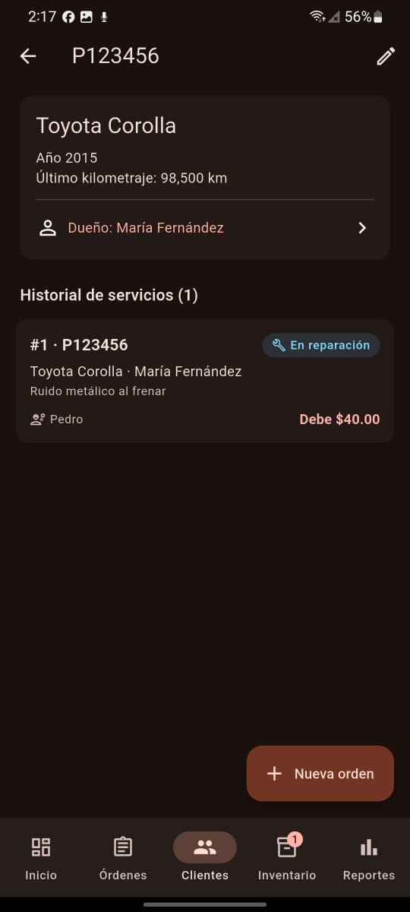 | 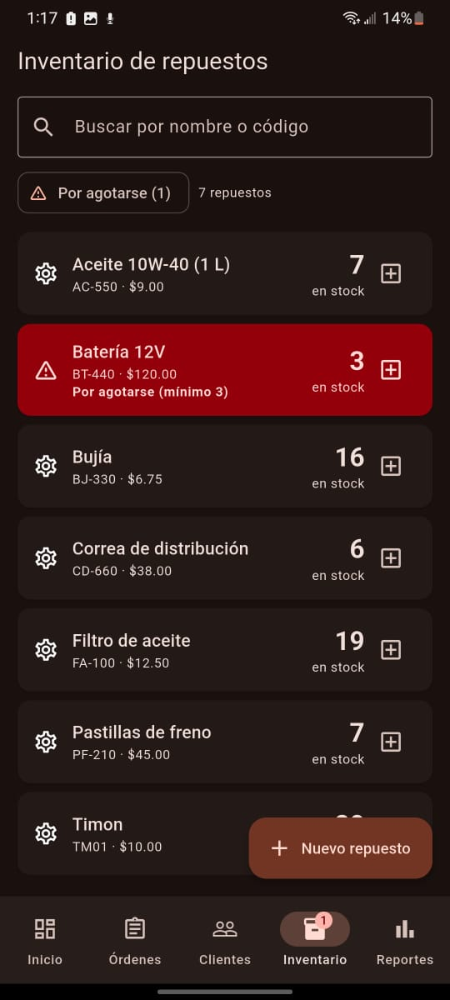 |
| Saldo pendiente, vehículos e historial | Todas las visitas de un vehículo | Repuestos por agotarse en rojo |

| Reportes | Reportes (órdenes) | Modo claro |
|:---:|:---:|:---:|
| 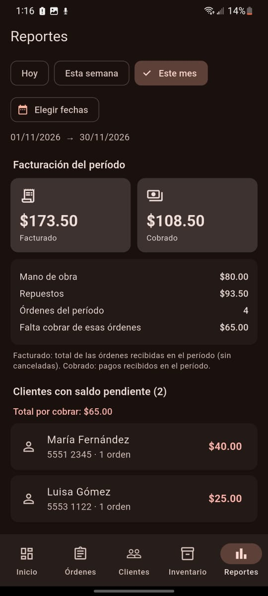 | 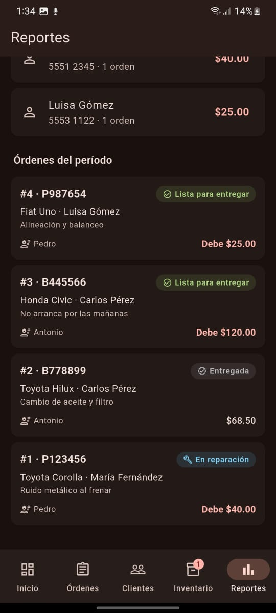 | 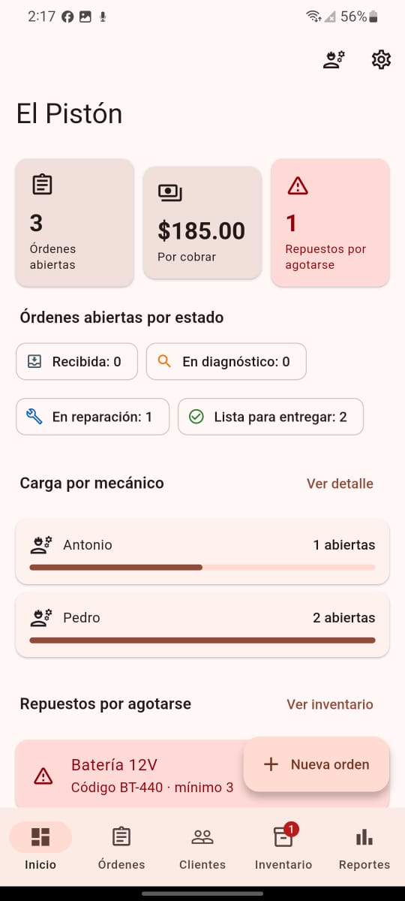 |
| Facturado, cobrado y deudas | Órdenes del período | Tema claro, además del oscuro |
